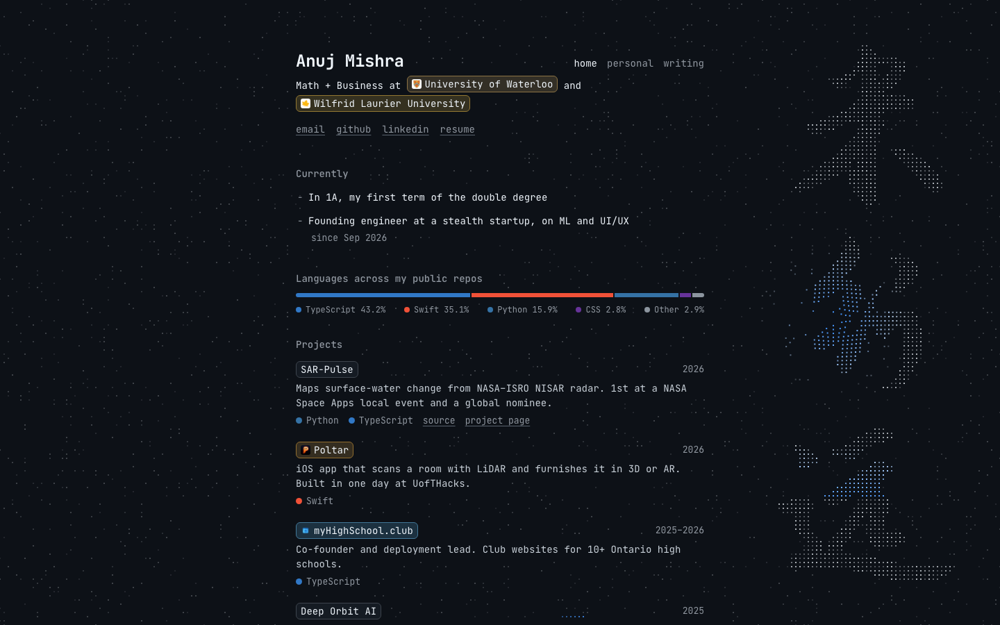

# anujmishra.dev

My personal site. I'm Anuj Mishra, a Math + Business student at the University of Waterloo and Wilfrid Laurier University.

**Live:** [anujmishra.dev](https://anujmishra.dev)



## What's on it

| Page | What it shows |
|---|---|
| **Home** (`index.html`) | What I'm doing now, projects, past roles, community work and awards, plus what I'm listening to on Spotify |
| **Personal** (`personal.html`) | A 2022 to 2031 timeline, the languages I speak, my top tracks this month, and what I use |
| **Writing** (`writing/`) | Essays, with an RSS feed |
| **404** (`404.html`) | A panda that couldn't find the page |

## Features

- **Interactive dot background.** My Chinese name, 米行远 (Mǐ Xíngyuǎn), is drawn in dots as a brush-script scroll in the right margin. Text knocks clean boxes out of the dots, dots near the cursor light up and lean away, ink runs down the name every few seconds, and small "travellers" wander across the grid (行远 means "to travel far"). It only runs on wide screens, draws a single still frame for `prefers-reduced-motion`, and pauses when the tab is hidden.
- **Live Spotify.** A Netlify Function reads what I'm playing (or played last) and my top tracks this month. If it can't be reached, those parts of the page stay hidden instead of breaking.
- **Badges.** Organizations and projects appear as small chips with their own icon, tinted in that icon's colour.
- **GitHub details.** GitHub's colours, language dots on projects, and a bar showing the languages across my public repos.
- **Light and dark themes** that follow the system setting, with a toggle that remembers your choice.
- **No JavaScript needed for content.** Everything is static HTML. Scripts only add the theme toggle, the year tabs, Spotify and the dots.

## Tech stack

Plain HTML, CSS and JavaScript. No framework, no build step, no npm dependencies on the site.

- **Hosting:** Netlify, with one Netlify Function for Spotify
- **Fonts:** Source Serif 4, self-hosted
- **CI:** a GitHub Actions link check with [lychee](https://github.com/lycheeverse/lychee), on every push and weekly

## Project structure

```
index.html                      Home page
personal.html                   Timeline, languages, music, what I use
writing/
  index.html                    List of posts
  <post>.html                   One file per post
  feed.xml                      RSS feed
404.html                        Not-found page (Netlify serves it automatically)

css/style.css                   All styles: light and dark colour tokens, layout, components
js/theme.js                     Light/dark toggle
js/years.js                     Year tabs on the personal page
js/spotify.js                   Fills the Spotify line and top tracks from /api/spotify
js/dots.js                      The interactive dot background

netlify/functions/spotify.mjs   Serves /api/spotify from the Spotify Web API

images/name.png                 1-bit mask of 米行远 that js/dots.js draws in dots
images/badges/                  16px icons for the badges
images/panda.png                Favicon and 404 panda
images/og.png                   Link preview image for social media
images/screenshot.png           The screenshot in this README

scripts/spotify-auth.mjs        One-time helper that gets the Spotify refresh token
scripts/render-name.py          Regenerates images/name.png
fonts/                          Self-hosted WOFF2 fonts
resume.pdf                      Linked from the header
```

## Running it locally

```sh
git clone https://github.com/anujmish1229/anujmishra.dev.git
cd anujmishra.dev
python3 -m http.server 8000      # or: npx serve
```

Then open http://localhost:8000. Everything works except Spotify, which needs the Netlify Function. To run that too, use the [Netlify CLI](https://docs.netlify.com/cli/get-started/) with the three variables below in a local `.env` file (it's gitignored):

```sh
npx netlify-cli dev
```

## Spotify setup

This is a one-time setup.

1. Create an app at [developer.spotify.com](https://developer.spotify.com/dashboard) with the redirect URI `http://127.0.0.1:8888/callback`, using the **Web API**.
2. In your own terminal (not anywhere that logs output), get a refresh token:

   ```sh
   read "SPOTIFY_CLIENT_ID?Client ID: "; read -s "SPOTIFY_CLIENT_SECRET?Client secret: "; echo
   export SPOTIFY_CLIENT_ID SPOTIFY_CLIENT_SECRET
   node scripts/spotify-auth.mjs
   ```

3. In Netlify, under **Site configuration > Environment variables**, add:

| Variable | Where it comes from |
|---|---|
| `SPOTIFY_CLIENT_ID` | Spotify developer dashboard |
| `SPOTIFY_CLIENT_SECRET` | Spotify developer dashboard |
| `SPOTIFY_REFRESH_TOKEN` | Output of `scripts/spotify-auth.mjs` |

The function asks Spotify for three permissions: `user-read-currently-playing`, `user-read-recently-played` and `user-top-read`. Responses are cached at Netlify's edge for 30 seconds.

## Editing content

All content lives in the HTML files.

- **Project, role or organization:** copy an existing `<li class="row">` block. Each row has a name, a date and one short line of detail.
- **Badge:** `<a class="badge" style="--tint:#46b5f4" href="…">Name</a>`. The icon and `--tint` colour are optional.
- **Post:** copy a file in `writing/`, then add it to `writing/index.html` and `writing/feed.xml`.
- **Language bar:** the percentages are static. To recount them from GitHub's byte counts across public repos:

  ```sh
  for r in $(gh repo list anujmish1229 --visibility public --source --limit 100 --json name --jq '.[].name'); do
    gh api repos/anujmish1229/$r/languages; echo
  done
  ```

  Then add up the bytes per language and update the widths and labels in the language bar in `index.html`.
- **Background name:** run `python scripts/render-name.py path/to/ZhiMangXing-Regular.ttf` (needs Pillow). The instructions are at the top of the script.
- **Styles:** after changing `css/style.css`, bump the `?v=` number in each page's stylesheet link so browsers fetch the new version.

## Credits

- 米行远 is drawn from [Zhi Mang Xing](https://fonts.google.com/specimen/Zhi+Mang+Xing) by Wei Zhimang, under the SIL Open Font License. Only the rendered mask ships with the site, not the font.
- Colours follow GitHub's [Primer](https://primer.style) palette.
- Badge icons belong to their organizations.
